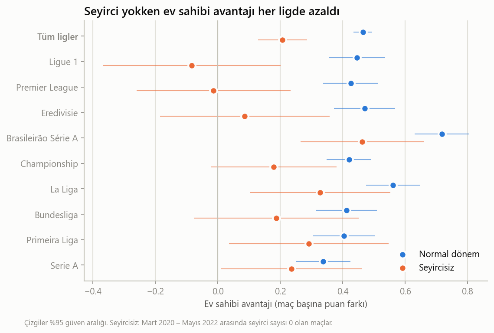
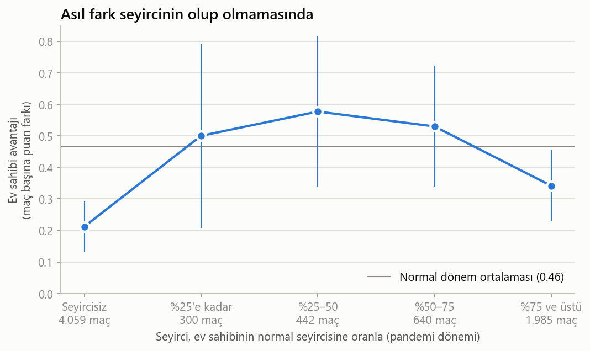
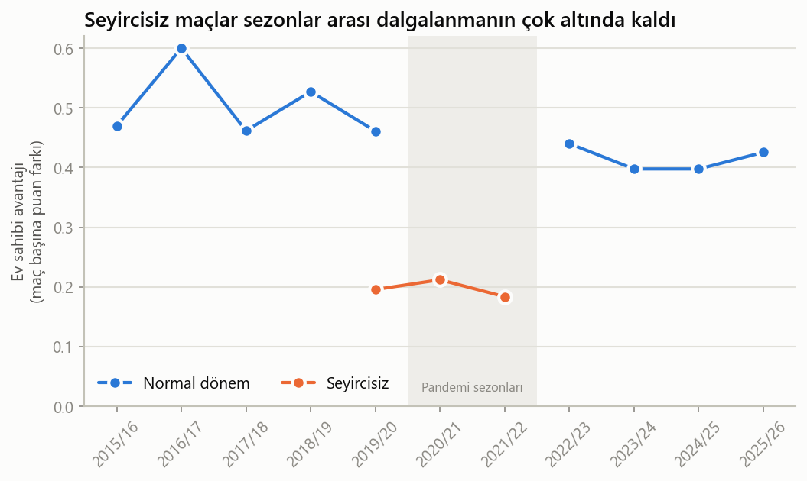
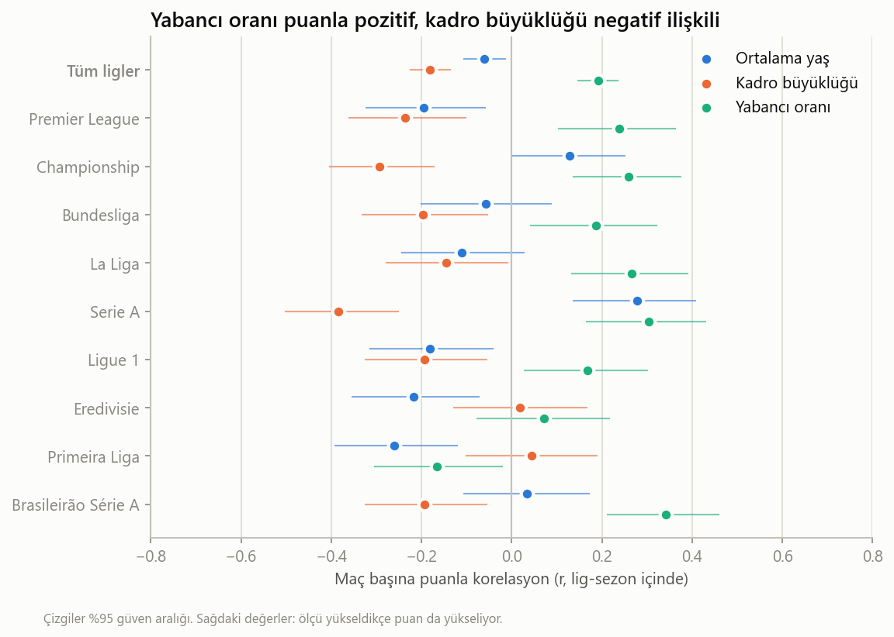
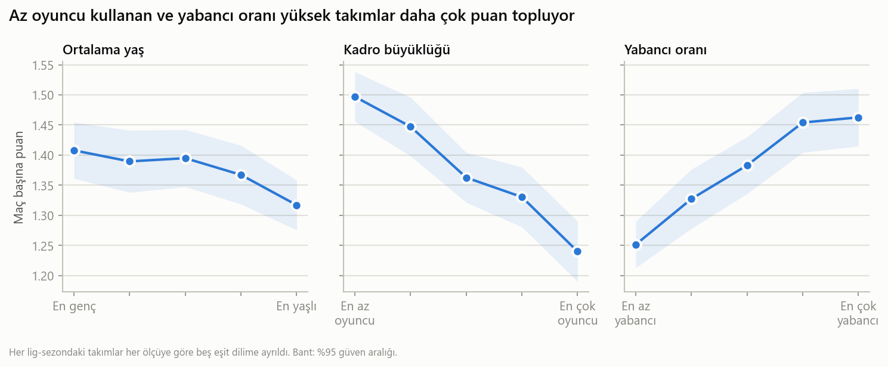
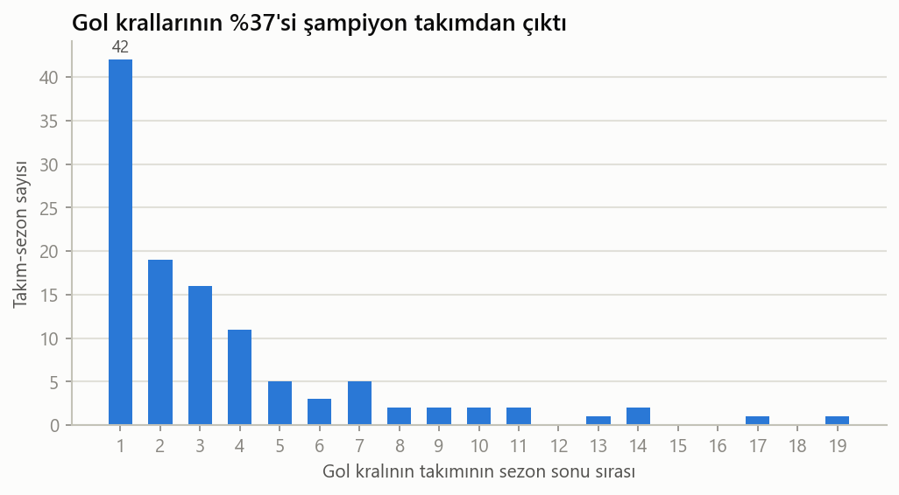
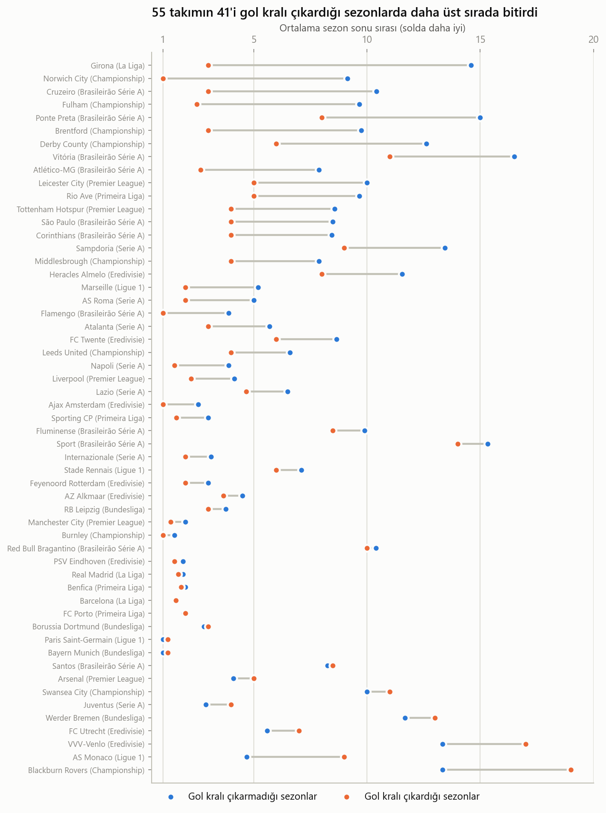

# Saha Dışı Faktörler

*API'den Veriye: Seyirci, Kadro Yapısı ve Gol Kralları*

*KOÜ Yazılım Kulübü AI Takımı · Proje 1 (Data & EDA)*

Bu projede 8 Avrupa ve 1 Güney Amerika liginin 2015/16–2025/26 sezonlarına ait verisi ESPN'in API'sinden toplandı, temizlendi ve üç araştırma sorusu için analiz edildi. Hazır bir CSV kullanılmadı. Veri setinin tamamı (yaklaşık 2.250 API yanıtı) bu repoda üretildi.

## Problem

### Seçilen API ve seçilme nedeni

Başlangıçta [football-data.org](https://www.football-data.org)'un ücretsiz planı planlandı. Ancak bu plan iki temel ihtiyacı karşılamıyor:

- **Geçmiş sezonlar:** Ücretsiz planda 2022 ve öncesi sezonlar erişime kapalı. Soru 1 için 2019/20–2021/22 pandemi sezonları ve öncesi gerekiyor.
- **Kadro verisi:** Kadro (squad) bilgisi ücretli planda.

Bu yüzden **ESPN'in herkese açık ama resmi olmayan API'si** kullanıldı (`site.api.espn.com`). Bu API anahtar istemiyor ve sorular için gereken her şeyi veriyor:

- 2015'ten bu yana maç sonuçları
- **Her maçın seyirci sayısı**
- Sezona özel kadrolar (doğum tarihi, uyruk ve oynanan maç sayısıyla)
- Gol krallığı listeleri
- Puan tabloları

### Araştırma soruları

1. **Ev sahibi avantajı değişiyor mu?** Seyirci, ev sahibine ne kadar avantaj sağlıyor? Pandemi döneminde seyircisiz oynanan maçlar normal dönemle karşılaştırıldı.
2. **Kadro yapısı sezon başarısını etkiliyor mu?** Kadronun ortalama yaşı, yabancı oyuncu oranı ve büyüklüğü, takımın sezon sonu başarısıyla ilişkili mi?
3. **Gol krallarının takımları gerçekten başarılı mı?** Gol kralı çıkaran takımlar, gol kralı çıkardıkları sezonlarda ortalama kaçıncı oluyor, çıkarmadıkları sezonlarda ortalama kaçıncı oluyor?

## Veri

| | |
|---|---|
| Kaynak | ESPN API (`site.api.espn.com`, resmi olmayan, anahtarsız) |
| Çekildiği tarih | 28 Ekim 2026 (son yeni yanıt 12.06 UTC'de indi; `data/raw/espn/_last_fetch.json`) |
| Kapsam | 9 lig × 11 sezon (2015/16–2025/26) |
| Ham veri | 2.257 JSON yanıtı, gzip'li toplam 59 MB (`data/raw/espn/`) |
| Temiz veri | 4 CSV dosyası, toplam 9 MB (`data/processed/`) |

**Ligler:**

| ESPN kodu | Lig |
|---|---|
| `eng.1` | Premier League |
| `eng.2` | Championship |
| `ger.1` | Bundesliga |
| `esp.1` | La Liga |
| `ita.1` | Serie A |
| `fra.1` | Ligue 1 |
| `ned.1` | Eredivisie |
| `por.1` | Primeira Liga |
| `bra.1` | Brasileirão Série A |

Sezon numarası başlangıç yılıdır: 2019 = 2019/20. Brasileirão'da sezon tek takvim yılında oynanıyor.

**Temizlenmiş tablolar:**

| Dosya | Satır | Sütun | Bir satır | Kullanılan alanlar |
|---|---|---|---|---|
| `matches.csv` | 36.642 | 12 | normal sezonda oynanmış bir maç | tarih, ev sahibi ve deplasman takımı, skor, sonuç (`H`/`D`/`A`), seyirci |
| `standings.csv` | 1.952 | 13 | bir takımın sezon sonu puan tablosu satırı | sıra, oynanan maç, galibiyet/beraberlik/mağlubiyet, goller, puan |
| `top_scorers.csv` | 116 | 8 | bir lig-sezonun gol kralı (eşitlikte birden çok) | oyuncu, takım, gol sayısı, kaynak (`source`) |
| `players.csv` | 63.006 | 13 | bir takımın sezon kadro listesindeki bir oyuncu | doğum tarihi, sezon ortası yaşı, uyruk, yabancı mı, pozisyon, lig maçı sayısı, takımın verisi tam mı (`team_complete`) |

## Yöntem

### Toplama (`src/collect.py`)

| Veri | Endpoint | İstek birimi |
|---|---|---|
| Puan tablosu | `/apis/v2/sports/soccer/{lig}/standings?season=YYYY` | lig × sezon |
| Gol krallığı | `/apis/site/v2/sports/soccer/{lig}/statistics?season=YYYY` | lig × sezon |
| Kadro | `/apis/site/v2/sports/soccer/{lig}/teams/{takım}/roster?season=YYYY` | takım × sezon |
| Maçlar ve seyirci | `/apis/site/v2/sports/soccer/{lig}/scoreboard?dates=YYYY&limit=1000` | lig × takvim yılı |

- Her istekte `timeout` ve `raise_for_status` var. İstekler arasında 1 saniye bekleniyor. 429 ve 5xx hatalarında istek artan aralıklarla yeniden deneniyor.
- Ham yanıtlar olduğu gibi, gzip'li olarak kaydediliyor. Script indirilmiş dosyaları atladığı için yeniden çalıştırmak API'ye tekrar istek atmıyor ve yarıda kesilirse kaldığı yerden devam ediyor.
- Tam toplama 2.233 istekte, yaklaşık 53 dakikada, hatasız tamamlandı.

### Temizlik (`notebooks/01_cleaning.ipynb`)

Rehberdeki kontroller (tekrar eden kayıtlar, veri tipleri, eksik değerler, tutarsız kategoriler, aykırı değerler) her tabloya sırayla uygulandı. Her kararın gerekçesi notebook'ta yazılı. Başlıca kararlar:

- **Normal sezon:** Play-off ve baraj maçları, ESPN'in sezon tipi alanına göre ayrıldı. Kontrol olarak her lig-sezonda maç sayısının takım × (takım − 1) olduğu doğrulandı.
- **Tamamlanmamış maçlar:** 206 maç çıkarıldı. Bunların 176'sı iptal edildi (örneğin Ligue 1 ve Eredivisie 2019/20), 3'ü yarıda kaldı. 27'si ise gerçekte oynandığı halde ESPN'de durumu güncellenmemiş maçlar.
- **Seyirci:** Mart 2020 – Mayıs 2022 arasında seyirci sayısı 0 olan maçlar *seyircisiz* kabul edildi. Bu dönem dışındaki 0'lar eksik veri sayıldı (319 maç, çoğu Brasileirão 2016 ve 2018). Fiziksel olarak imkânsız bir değer (24 bin kişilik stadyumda 146.013 seyirci) silindi.
- **Puan:** ESPN'in puan silme (`deductions`) alanı gerçek cezaları göstermediği için atıldı. Resmi puan `points` alanından alındı.
- **Gol krallığı:** 91 lig-sezonda ESPN'in hazır listesi kullanıldı. Listesi olmayan 8 lig-sezonda gol kralı, maç detaylarındaki gol olaylarından sayıldı. Bu yöntem listesi olan 91 lig-sezonda denendi ve 87'sinde aynı gol kralını buldu.
- **Kadro:** Kadro, o sezon **en az 1 lig maçına çıkan** oyuncular olarak tanımlandı. Ham kadro listeleri hiç oynamamış gençleri de içeriyor (bir takımda 53 kişiye kadar). Maç sayısı verisi eksik olan takım-sezonlar Soru 2'nin dışında bırakıldı.
- **Yaş:** Yaş sezon ortasına göre hesaplandı: Avrupa liglerinde sezonun ikinci yılının 1 Ocak'ı, Brasileirão'da 1 Temmuz. 16 yaşından küçük ya da 50 yaşından büyük çıkan yaşlar hatalı doğum tarihi sayıldı.
- **Yabancı oyuncu:** Yabancılık uyruğa göre belirlendi; uyruk lig ülkesinden farklıysa oyuncu yabancı. İngiliz liglerinde England, Wales, Scotland ve Northern Ireland yerli sayıldı, çünkü hepsi Birleşik Krallık vatandaşı ve Galli kulüpler de bu liglerde oynuyor. Republic of Ireland yabancı sayıldı.

### Analiz (`notebooks/02_analysis.ipynb`)

- **Soru 1:**
  - Ev sahibi avantajı, bir maçta ev sahibinin aldığı puan ile deplasman takımının aldığı puan arasındaki fark (3/1/0) olarak ölçüldü ve maç başına ortalaması alındı.
  - Kısmi seyirci için tek bir eşik seçilmedi. Her maçtaki seyirci, ev sahibinin normal dönemdeki ortanca seyircisine oranlandı ve bu doluluk oranı dilimlere ayrıldı.
- **Soru 2:**
  - Her ölçü ve maç başına puan, takımın kendi lig-sezonu içinde standartlaştırıldı. Böylece ligler ve sezonlar arasındaki yapısal farklar ayıklandı.
  - Korelasyon her lig için ayrı hesaplandı. İlişkinin şekline lig-sezon içindeki beşte birlik dilimlerle bakıldı.
- **Soru 3:** Aynı takımın aynı ligdeki gol kralı çıkardığı ve çıkarmadığı sezonlarının ortalama sırası karşılaştırıldı.
- Belirsizlik %95 güven aralıklarıyla gösterildi.

## Bulgular

### 1. Seyirci, ev sahibi avantajının yarısından fazlasını oluşturuyor

Normal dönemde ev sahibi, deplasman takımından maç başına **0,46 puan** fazla topluyor. Seyircisiz oynanan 4.100 maçta bu fark **0,21'e** düştü, yani avantajın %55'i kayboldu. Ev sahibi galibiyet oranı da %45,1'den %40,5'e indi.



Düşüş dokuz ligin hepsinde görülüyor. En büyük düşüş Ligue 1, Premier League ve Eredivisie'de; bu liglerde seyircisiz maçlarda avantaj neredeyse sıfırlanıyor.



Normal seyircinin %25'inden az seyirciyle oynanan maçlarda bile avantaj normal seviyeye dönüyor. Yani seyircinin sayısından çok, stadyumda seyirci bulunup bulunmaması belirleyici görünüyor. Ancak kısıtlı seyirciyle oynanan maç sayısı az, bu yüzden güven aralıkları geniş.



Seyircisiz maçlardaki değer (0,18–0,21), normal dönemde sezondan sezona görülen dalgalanmanın (0,40–0,60) çok altında. Bu yüzden düşüş genel bir eğilimle açıklanamıyor. Pandemiden sonra avantaj, pandemi öncesine göre biraz düşük kaldı: ortalama 0,51'den 0,42'ye.

### 2. Kadro yapısının başarıyla ilişkisi zayıf; yaşın tutarlı bir etkisi yok



Analize 1.730 takım-sezon girdi.

- **Yabancı oranı:** Yabancı oranı yüksek takımlar lig içinde daha çok puan topluyor (r = 0,19). Bu ilişki 9 ligin 8'inde görülüyor; istisna Portekiz Primeira Liga.
- **Kadro büyüklüğü:** Daha az oyuncu kullanan takımlar daha başarılı (r = −0,18). Ancak ilişki ters yönlü olabilir: kötü giden takımlar teknik direktör değiştiriyor ve daha çok oyuncu deniyor.
- **Ortalama yaş:** Ligler genelinde tutarlı bir ilişki yok (r = −0,06). Serie A'da yaşlı kadrolar, Portekiz ve Hollanda'da genç kadrolar daha başarılı.



En az oyuncu kullanan dilim maç başına 1,50 puan toplarken, en çok oyuncu kullanan dilim 1,24 puan topluyor. Yabancı oranında en düşük dilim 1,25, en yüksek dilim 1,46 puan topluyor. 38 maçlık bir sezonda bu farklar yaklaşık 8–10 puana denk geliyor. Yine de her bir ölçü, takımlar arasındaki puan farkının %4'ünden azını açıklıyor.

### 3. Gol kralı çıkaran takımlar o sezonlarda ortalama 2 sıra daha üstte bitiriyor



Gol krallarının %37'si şampiyon takımdan, %77'si ilk dört takımdan çıkıyor.



Gol kralı çıkaran 55 takımın ortalama sırası, gol kralı çıkardıkları sezonlarda **4,9**, diğer sezonlarında **7,0**. Fark 2,1 sıra (%95 güven aralığı 1,3–3,0). 55 takımın 41'i gol kralı çıkardığı sezonlarda daha üst sırada bitirmiş. Bu sonuç bir neden-sonuç ilişkisi kurmuyor: takım iyi oynadığı için forveti daha çok gol atıyor olabilir, ya da tersi.

## Sınırlılıklar

- **Resmi olmayan API:** ESPN API'sinin dokümanı ve yayınlanmış bir kullanım limiti yok, endpoint'ler değişebilir. Ham yanıtlar repoda saklandığı için analiz API'ye bağlı kalmadan tekrar üretilebiliyor.
- **Oyuncu istatistiği boşlukları:** ESPN 8 lig-sezonda oyuncu istatistiği hiç tutmamış: Premier League, La Liga ve Primeira Liga 2020/21; Championship, Bundesliga ve Serie A 2018/19; Eredivisie 2019/20; Brasileirão 2019. 2 lig-sezonda ise kadro listesi boş: Ligue 1 2021/22 ve Serie A 2023/24. Bu nedenle:
  - 222 takım-sezon Soru 2'ye alınmadı.
  - 8 lig-sezonun gol kralı, maç detaylarındaki gollerden hesaplandı. Bu yöntem birkaç golü kaçırabiliyor.
- **Seyirci verisi:** ESPN eksik seyirci verisini de 0 olarak giriyor. Pandemi dönemindeki 0'ların gerçekten seyircisiz maçlar olduğu varsayıldı.
- **Pandemide değişen başka koşullar:** Pandemi döneminde seyirci dışında başka şeyler de değişti: 5 oyuncu değişikliği kuralı, sıkışık fikstür, farklı seyahat koşulları. Soru 1'deki düşüşün tamamı seyirciye bağlanamaz.
- **Hatalı doğum tarihleri:** Bariz hatalı doğum tarihleri ayıklandı. Makul bir yaşa denk gelen hatalı tarihler ise yakalanamıyor.
- **Uyruk:** ESPN her oyuncu için tek bir uyruk veriyor; çift vatandaşlar tek uyrukla sayıldı. Yabancı oranı oyuncuların kural statüsünü (home-grown, AB dışı oyuncu kotası) değil, uyruk çeşitliliğini ölçüyor.
- **Kadro büyüklüğü:** Bu ölçü "kullanılan oyuncu sayısı" anlamına geliyor. Lig maçı sayısına bazı liglerde play-off maçları da karışmış (1–2 maç).
- **Korelasyon:** Soru 2 ve 3'teki ilişkiler korelasyon; neden-sonuç ilişkisi göstermiyor. Soru 3'ün örneklemi 55 takımla sınırlı.

## Çalıştırma

Proje Python 3.14 ile hazırlandı ve test edildi.

```bash
pip install -r requirements.txt

# 1) Ham veriyi topla (isteğe bağlı: data/raw/ repoda hazır)
python src/collect.py
#    Var olan dosyalar atlanır. Veriyi sıfırdan çekmek için önce data/raw/espn/ klasörünü silin
#    (yaklaşık 2.250 istek, 1 saat). Sadece bazı lig ve sezonlar için:
#    python src/collect.py --leagues eng.1 --seasons 2019 2020

# 2) Notebook'ları sırayla çalıştır (Restart & Run All)
jupyter notebook notebooks/01_cleaning.ipynb   # data/raw -> data/processed
jupyter notebook notebooks/02_analysis.ipynb   # data/processed -> figures/
```

API anahtarı gerekmiyor.

## Proje yapısı

```
├── src/
│   ├── collect.py              # ESPN'den ham veriyi toplar
│   └── parse.py                # ham JSON -> düz tablolar (temizlik kararı vermez)
├── data/
│   ├── raw/espn/               # API'den gelen ham yanıtlar (.json.gz)
│   └── processed/              # temizlenmiş CSV'ler
├── notebooks/
│   ├── 01_cleaning.ipynb       # temizlik kontrolleri ve kararları
│   └── 02_analysis.ipynb       # keşifsel analiz ve grafikler
├── figures/                    # kaydedilen grafikler
├── requirements.txt
└── README.md
```
